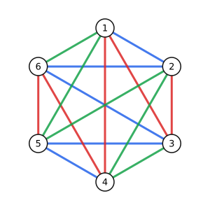
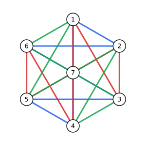

::: {.cover}
# پازل

### راه‌حل تشریحی

از راهنمایی‌های کوچک تا راه‌حل کامل
:::

::: {.box .howto}
**چطور این متن را بخوانید؟**
این متن طوری نوشته شده که اگر هنوز مسئله را حل نکرده‌اید، بتوانید قدم‌به‌قدم جلو بروید.
بخش «راهنمایی‌ها» را یکی‌یکی بخوانید و بعد از هر کدام چند دقیقه فکر کنید.
راه‌حل هر زیرمسئله بعد از راهنمایی‌ها آمده است.
:::

## یادآوری مسئله

یک جایگشت مخفی $a$ از $1, \ldots, n$ داریم. در هر *چینش* یک جایگشت $b$ می‌پرسیم و برای هر $i$
می‌فهمیم که آیا $b_{i+1}$ دقیقاً بلافاصله بعد از $b_i$ در $a$ آمده است یا نه.
باید $a$ را با حداکثر $q$ چینش پیدا کنیم؛ در مسئله‌ی کامل $q = n-1$.

| زیرمسئله | امتیاز | شرط | ایده‌ی لازم |
|:-:|:-:|:--|:--|
| ۱ | ۱۰ | $n \le 3$ ، $q = n-1$ | حالت‌بندی |
| ۲ | ۱۵ | $q = 2n$ | راهبرد تطبیقی حریصانه |
| ۳ | ۲۰ | $q = n$ | آزمودن همه‌ی زوج‌ها |
| ۴ | ۲۵ | $n$ فرد ، $q = n-1$ | دورهای والکی و استنتاج |
| ۵ | ۳۰ | $q = n-1$ | یک رأس اضافه و یک چینش تطبیقی |

# نردبان راهنمایی‌ها

::: {.box .hint}
**راهنمایی ۱ — زبان مناسب.**
جایگشت $a$ را یک *مسیر همیلتونی جهت‌دار* روی رأس‌های $1..n$ ببینید: یال $a_j \to a_{j+1}$.
هر چینش $b$ هم یک مسیر همیلتونی است. جواب چینش دقیقاً می‌گوید کدام یال‌های $b$ در مسیر مخفی هم هستند.
:::

::: {.box .hint}
**راهنمایی ۲ — آزمایش.**
بگویید چینش $b$ زوج مرتب $(x, y)$ را *آزمایش* می‌کند اگر $y$ بلافاصله بعد از $x$ در $b$ آمده باشد.
هر چینش دقیقاً $n-1$ زوج مرتب را آزمایش می‌کند. اگر زوجی آزمایش شود، تکلیف آن (یال هست یا نیست) برای همیشه روشن است.
:::

::: {.box .hint}
**راهنمایی ۳ — بشمارید!**
تعداد کل زوج‌های مرتب $n(n-1)$ است. با $n-1$ چینش حداکثر $(n-1)^2$ آزمایش داریم. پس دست‌کم
$$n(n-1) - (n-1)^2 = n-1$$
زوج آزمایش‌نشده می‌ماند — و اگر حتی یک آزمایش تکراری داشته باشیم، بیشتر. پس همه‌چیز باید *دقیق* باشد.
سؤال اصلی: **کدام $n-1$ زوج را می‌توان آزمایش نکرد و باز هم جواب را با قطعیت فهمید؟**
:::

::: {.box .hint}
**راهنمایی ۴ — یک ستاره.**
هر رأس حداکثر یک جانشین دارد. اگر همه‌ی زوج‌ها جز $n-1$ زوجِ $v \to x$ (یال‌های خروجی از یک رأس ثابت $v$) آزمایش شوند،
چه چیزی مجهول می‌ماند؟ آیا آن را می‌توان استنتاج کرد؟
:::

::: {.box .hint}
**راهنمایی ۵ — $v$ همیشه آخر.**
یال‌های خروجی از $v$ آزمایش نمی‌شوند اگر و تنها اگر $v$ در *همه‌ی* چینش‌ها آخر باشد.
با حذف $v$ از آخر هر چینش، چه ساختاری روی بقیه‌ی رأس‌ها لازم است؟ (اگر $v$ را به ابتدای هر چینش هم «وصل» کنید، چه شکلی می‌بینید؟)
:::

::: {.box .hint}
**راهنمایی ۶ — زیگ‌زاگ.**
$2r$ نقطه را روی یک دایره بگذارید. از نقطه‌ی $i$ شروع کنید و یک‌درمیان به راست و چپ بروید:
$i,\ i+1,\ i-1,\ i+2,\ i-2,\ \ldots,\ i+r$. با $i = 0, 1, \ldots, r-1$ چه چیزی به دست می‌آید؟
:::

::: {.box .hint}
**راهنمایی ۷ — وقتی $n$ زوج است.**
برای $n=4$ و $n=6$ هیچ ساختار ثابتی از نوع راهنمایی ۵ وجود ندارد. پس کمی *تطبیق* لازم است.
یک رأس $w$ را کنار بگذارید، روی $n-1$ رأس دیگر (که تعدادشان فرد است) کار زیرمسئله‌ی ۴ را بکنید،
و $w$ را جایی در هر چینش قرار دهید که بیشترین اطلاعات را بدهد.
:::

::: {.box .hint}
**راهنمایی ۸ — آخرین چینش را نگه دارید.**
بعد از $n-2$ چینش، فقط چند یال کلیدی مجهول مانده‌اند. یال‌های پیدا شده قطعه‌ها را به چند *زنجیره* تبدیل می‌کنند.
چند زنجیره و چند حالت ممکن باقی مانده؟ آیا یک چینش می‌تواند همه‌ی حالت‌ها را از هم جدا کند؟
:::

# زیرمسئله‌ی ۱: $n \le 3$

- **$n = 2$:** چینش $(1, 2)$ را بپرسید. اگر جواب `1` بود $a = (1,2)$ وگرنه $a = (2,1)$.
- **$n = 3$:** چینش $(1,2,3)$ را بپرسید.
  - جواب `11`: همین جواب است.
  - جواب `10` یا `01`: یکی از یال‌ها معلوم است و دو زنجیره داریم؛ ترتیب دیگرِ زنجیره‌ها همان است که آزمایش شده و رد شده، پس جواب یکتاست.
  - جواب `00`: سه حالت می‌ماند: $(1,3,2)$، $(2,1,3)$ و $(3,2,1)$. چینش $(3,2,1)$ برای این سه حالت به‌ترتیب `10`، `01` و `11` می‌دهد.

راه دیگر: همه‌ی جایگشت‌های سازگار با جواب‌ها را نگه دارید و هر بار چینشی بپرسید که بزرگ‌ترین دسته‌ی جواب‌ها را کمینه کند.
این همان `brute.cpp` است و جالب است که تا $n=6$ هم با $n-1$ چینش جواب می‌دهد.

# زیرمسئله‌ی ۲: $q = 2n$ — حریصانه روی زنجیره‌ها

یال‌های پیدا شده قطعه‌ها را به *زنجیره* تبدیل می‌کنند. در هر چینش زنجیره‌ها را پشت هم بگذارید طوری که بعد از انتهای هر زنجیره
ابتدای زنجیره‌ای بیاید که این زوج هنوز آزمایش نشده است. هر بار یالی پیدا شد زنجیره‌ها ادغام می‌شوند؛ وقتی دو زنجیره ماند
و یکی از دو ترتیب قبلاً رد شده، ترتیب دیگر جواب است.

در عمل این روش روی ورودی‌های بزرگ تصادفی حتی کمتر از $n$ چینش لازم دارد (چون جفت‌شدن‌های تصادفی زیادند)،
اما روی ورودی‌های کوچک بدترین حالت از $n$ بیشتر می‌شود؛ مثلاً برای $n=4$ تا ۶ چینش.
آزمون‌های زیرمسئله‌های ۳ تا ۵ شامل **همه‌ی** جایگشت‌های کوچک‌اند، پس این روش فقط زیرمسئله‌ی ۲ را می‌گیرد.

::: {.box .warn}
**درس مهم:** در این مسئله آزمون‌های تصادفی بزرگ تقریباً هیچ راه‌حلی را رد نمی‌کنند؛ قاتلِ راه‌حل‌های اکتشافی، همه‌ی جایگشت‌های $n$های کوچک است.
:::

# زیرمسئله‌ی ۳: $q = n$ — همه‌ی زوج‌ها را بیازمایید

با $n$ چینش می‌توانیم $n(n-1)$ آزمایش داشته باشیم، یعنی دقیقاً به اندازه‌ی همه‌ی زوج‌های مرتب.
پس کافی است گراف کامل جهت‌دار را به $n$ مسیر همیلتونی **افراز** کنیم؛ آن‌وقت همه‌ی یال‌ها معلوم می‌شوند.

**$n$ زوج.** $n$ نقطه‌ی $0, \ldots, n-1$ را روی دایره بگذارید و $h = n/2$. مسیر زیگ‌زاگ
$$Z_i = (i,\ i+1,\ i-1,\ i+2,\ i-2,\ \ldots,\ i+h) \pmod n, \qquad i = 0, \ldots, h-1$$
را بسازید. این $h$ مسیر، یال‌های گراف کامل *بی‌جهت* را دقیقاً یک‌بار می‌پوشانند
(در هر مسیر، طول وترها همه‌ی مقدارهای ممکن را می‌گیرد و با چرخاندن مسیر، هر وتر دقیقاً یک‌بار پوشیده می‌شود).
هر مسیر را یک‌بار از ابتدا و یک‌بار از انتها بپرسید: $2h = n$ چینش و هر زوج مرتب دقیقاً یک‌بار آزمایش می‌شود.

::: {.figure}

شکل ۱ — برای $n = 6$ سه مسیر زیگ‌زاگ همه‌ی ۱۵ یال را دقیقاً یک‌بار می‌پوشانند.
:::

**$n$ فرد.** ساختار زیرمسئله‌ی ۴ (پایین) با $n-1$ چینش، و یک چینش اضافه برای یال باقی‌مانده.

# زیرمسئله‌ی ۴: $n$ فرد — دورهای والکی

طبق راهنمایی ۳ دقیقاً $n-1$ زوج باید بی‌آزمایش بمانند. راهنمایی ۴ پیشنهاد می‌کند این زوج‌ها همه‌ی یال‌های خروجی
از یک رأس ویژه باشند؛ اسمش را $\infty$ بگذارید (در کد: رأس $n$).

**چرا استنتاج ممکن است؟** فرض کنید همه‌ی زوج‌ها جز $\infty \to x$ آزمایش شده‌اند. پس همه‌ی یال‌های مسیر مخفی پیدا شده‌اند،
جز احتمالاً یالِ خروجی از $\infty$.

- اگر $\infty$ آخرین قطعه باشد، همه‌ی $n-1$ یال پیدا شده و تمام.
- وگرنه دقیقاً دو زنجیره داریم: زنجیره‌ی $A$ که به $\infty$ ختم می‌شود و زنجیره‌ی $B$.
  ترتیب $B$ بعد از $A$ یالی از $\infty$ می‌خواهد (آزمایش نشده)، ولی ترتیب $A$ بعد از $B$ یالی را می‌خواهد که آزمایش و *رد* شده.
  پس جواب $A$ و سپس $B$ است.

**ساختن چینش‌ها.** $\infty$ همیشه آخر است. $n-1 = 2r$ رأس دیگر را روی دایره بگذارید و برای $i = 0, \ldots, r-1$ بپرسید:
$$(Z_i,\ \infty) \quad\text{و}\quad (\mathrm{reverse}(Z_i),\ \infty).$$
این $2r = n-1$ چینش است و:

- هر زوج مرتب بین رأس‌های دایره دقیقاً یک‌بار آزمایش می‌شود (زیگ‌زاگ در هر دو جهت)؛
- زوج‌های $x \to \infty$ هم هر کدام یک‌بار: آخرین رأسِ $Z_i$ برابر $i+r$ و آخرین رأسِ برعکسش $i$ است، که با هم همه‌ی دایره را می‌پوشانند؛
- و زوج‌های $\infty \to x$ هرگز — دقیقاً همان چیزی که می‌خواستیم.

::: {.figure}

شکل ۲ — برای $n = 7$: اگر رأس ۷ را به هر دو سر مسیرهای زیگ‌زاگ وصل کنیم، سه دور همیلتونی به دست می‌آید
که با دو جهت‌شان همه‌ی ۴۲ زوج مرتب را دقیقاً یک‌بار می‌پوشانند. بریدن هر دور در رأس ۷ یک چینش می‌دهد.
:::

::: {.box .note}
**پشت پرده.** چیزی که ساختیم یک *تجزیه‌ی گراف کامل جهت‌دار به دورهای همیلتونی* است که در $\infty$ بریده شده‌اند.
این همان ساخت قدیمی والکی (Walecki) برای افراز گراف کامل با تعداد رأس فرد به دورهای همیلتونی است.
:::

# زیرمسئله‌ی ۵: حالت کلی

## چرا $n$ زوج سخت است؟

اگر بخواهیم دقیقاً مثل زیرمسئله‌ی ۴ عمل کنیم، باید گراف کامل جهت‌دار با $n$ رأسِ زوج را به $n-1$ دور همیلتونی جهت‌دار افراز کنیم.
قضیه‌ای از تیلسون (Tillson, 1980) می‌گوید این کار برای $n = 4$ و $n = 6$ **ناممکن** است و برای بقیه‌ی مقدارهای زوجِ $n$ ممکن
ولی ساختش پیچیده است. پس به‌جای ساختار کاملاً ثابت، از یک چینش تطبیقی استفاده می‌کنیم.

## الگوریتم

۱. رأس $w = n$ را کنار بگذارید. روی $n-1$ رأس دیگر (تعداد فرد) با $\infty = n-1$ ساخت زیرمسئله‌ی ۴ را اجرا کنید
   و **$w$ را اول هر چینش بگذارید**: $(w,\ Z_i,\ \infty)$ و $(w,\ \mathrm{reverse}(Z_i),\ \infty)$. این $n-2$ چینش است.

۲. ببینیم چه چیزی آزمایش نشده:

| زوج‌های آزمایش‌نشده | دلیل |
|:--|:--|
| $x \to w$ برای هر $x$ | $w$ همیشه اول است |
| $\infty \to x$ برای هر $x$ | $\infty$ همیشه آخر است |
| $w \to \infty$ | بعد از $w$ همیشه یک رأسِ دایره می‌آید |

زوجِ $w \to x$ برای هر رأس دایره آزمایش می‌شود، چون اولین رأسِ $Z_i$ و برعکسش همه‌ی دایره را می‌پوشانند.

۳. پس از یال‌های مسیر مخفی حداکثر **سه** یال مجهول است: یالِ ورودی به $w$، یال $w \to \infty$ (اگر وجود داشته باشد) و یال خروجی از $\infty$.
بنابراین یال‌های پیدا شده قطعه‌ها را به **حداکثر ۴ زنجیره** تقسیم می‌کنند.

۴. همه‌ی ترتیب‌های این زنجیره‌ها (حداکثر $4! = 24$ ترتیب) را امتحان کنید و آن‌هایی را نگه دارید که هیچ پیوندشان
قبلاً آزمایش و رد نشده باشد. این‌ها *نامزدها* هستند؛ همیشه حداکثر **۳** نامزد می‌ماند.

۵. اگر یک نامزد ماند، همان جواب است. وگرنه در میان همه‌ی ترتیب‌های زنجیره‌ها، ترتیبی را پیدا کنید که برای نامزدهای مختلف
جواب‌های متفاوت بدهد، آن را به‌عنوان چینش $n-1$-ام بپرسید و نامزد درست را گزارش کنید.

::: {.box .note}
**چرا مرحله‌ی ۵ همیشه موفق است؟** وضعیت آخر فقط به «شکل» زنجیره‌ها بستگی دارد: حداکثر ۴ زنجیره، و این‌که $w$ و $\infty$
کجای آن‌ها هستند. تعداد این شکل‌ها محدود است و همه‌شان در $n$های کوچک ظاهر می‌شوند. الگوریتم روی **همه‌ی** جایگشت‌های
$n \le 10$ (بیش از ۴ میلیون حالت) آزمایش شده و همیشه حداکثر ۴ زنجیره، حداکثر ۳ نامزد و یک چینش جداکننده پیدا کرده است.
:::

## نمونه‌ی کوچک: $n = 2$

$w = 2$ و $\infty = 1$ و هیچ زیگ‌زاگی وجود ندارد ($r = 0$). دو زنجیره‌ی $\{1\}$ و $\{2\}$ و دو نامزد داریم.
چینش $(1, 2)$ آن‌ها را از هم جدا می‌کند: دقیقاً همان یک چینش مجاز.

## پیچیدگی

ساخت هر چینش $O(n)$ است، پس کل خروجی $O(n^2)$ برای هر مورد آزمون و $O(\sum n^2)$ در کل است.
مرحله‌ی آخر روی حداکثر ۲۴ ترتیب کار می‌کند و هر کدام $O(n)$ هزینه دارد.

# اشتباه‌های رایج

| اشتباه | نتیجه |
|:--|:--|
| حدس زدن به‌جای پرسیدن چینش آخر در حالت $n$ زوج | جواب غلط در حالت‌های مبهم |
| گذاشتن زنجیره‌ی $\infty$ در انتها به‌جای ابتدا | جواب غلط در اکثر آزمون‌های فرد |
| جاانداختن یک زیگ‌زاگ (خطای یکی کمتر در حلقه) | زنجیره‌های زیاد و حدس غلط |
| آزمودن همه‌ی زوج‌ها با $n$ چینش | بیش از حد مجاز در $q = n-1$ |
| حریصانه یا تصادفی | روی $n$های کوچک از حد مجاز می‌گذرد |
| فلاش نکردن خروجی | برنامه تا پایان زمان منتظر می‌ماند |
| ادامه دادن بعد از دریافت $-1$ | نتیجه‌ی نامشخص |

# پیاده‌سازی مرجع

کد زیر همان `model.cpp` است.

CODE_PLACEHOLDER
